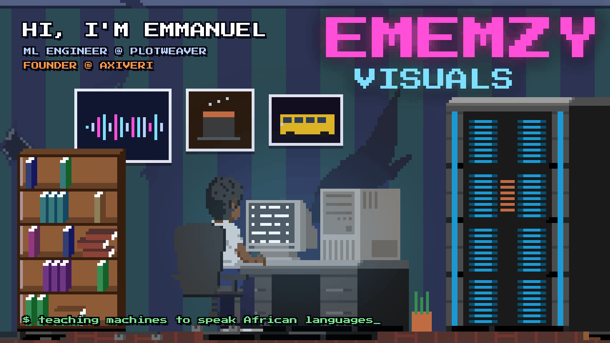
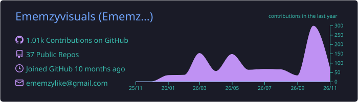
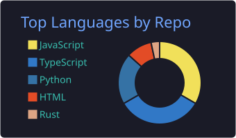
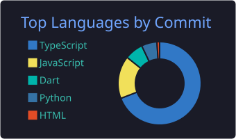
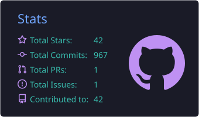
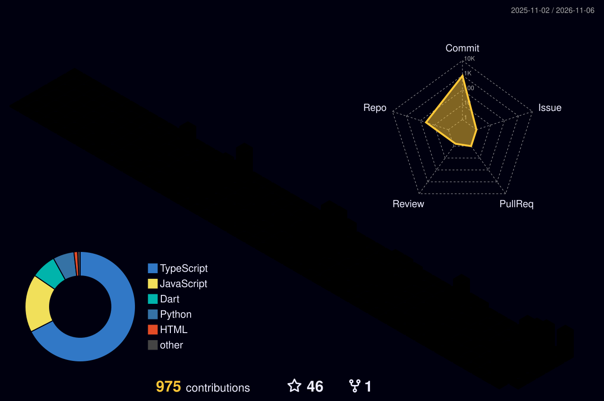

 

 

## About

I'm a Machine Learning Engineer on the speech AI team at **PlotWeaver** and the founder of **[Axiveri](https://huggingface.co/Axiveri)**. I build voices that sound like people from Lagos, Kano and Enugu, not like a reader: text to speech with emotion and expression, speech recognition that copes with real, code-switched speech, and translation between English, Yoruba, Hausa, Igbo and Nigerian Pidgin.

Outside the models I build full-stack products and small browser games. Self-taught, based in Nigeria, open to collaborations, research partnerships and serious products.

## Open models

| Model | What it does | Link |
|---|---|---|
| **NaijaVox 2.0** | Speech recognition for Yoruba, Hausa, Igbo, Pidgin and Nigerian English, including speech that switches between them | [Model](https://huggingface.co/Axiveri/NaijaVox-2.0) · [Demo](https://huggingface.co/spaces/Axiveri/Naijavox-Demo) |
| **WazobiaVoice** | Multilingual text to speech and zero-shot voice cloning, with Yoruba tone marks handled properly | [Model](https://huggingface.co/Axiveri/WazobiaVoice) |
| **Renpiper Pidgin** | A small, fast Nigerian Pidgin voice with an ONNX build for modest hardware | [Model](https://huggingface.co/Axiveri/Renpiper-pcm-V1) |
| **Africlaude-7B** | An open language model tuned for African context, with AfriclaudeBench to measure it | [Model](https://huggingface.co/Axiveri/Africlaude-7B) |
| **AfriVision** | A FLUX LoRA trained on AfriVision-30K, images of African people, places and culture | [Model](https://huggingface.co/Axiveri/AfriVision-Base) · [Dataset](https://huggingface.co/datasets/Axiveri/AfriVision-30K) |

## Products

| Project | What it is | Links |
|---|---|---|
| **ClaudGPT** | Multi-agent platform where AI agents build full-stack apps together | [Code](https://github.com/Ememzyvisuals/Claudgpt) · [Live](https://claudgpt.vercel.app) |
| **AethLife** | A personal life OS for habits, workouts and energy, guided by AI | [Code](https://github.com/Ememzyvisuals/Aethlife) · [Live](https://aethlife.vercel.app) |
| **FlonexTV** | Streaming with a built-in learning academy | [Code](https://github.com/Ememzyvisuals/FlonexTV) · [Live](https://flonextv.vercel.app) |
| **NaijaPrep** | Offline-first JAMB, WAEC and NECO prep that works on weak networks | [Code](https://github.com/Ememzyvisuals/NaijaPrep) · [Live](https://naijaprep.netlify.app) |
| **StudentHub NG** | Exam prep with streaks, analytics and a community | [Code](https://github.com/Ememzyvisuals/studenthub-ng) · [Live](https://studenthub-ng.vercel.app) |
| **StoreJet** | Build an online store in minutes, with WhatsApp checkout | [Code](https://github.com/Ememzyvisuals/storejet) · [Live](https://storejet-ng.netlify.app) |
| **Lumeo AI** | A Telegram assistant: chat, images, payments and games | [Code](https://github.com/Ememzyvisuals/Lumeo-tel-bot) · [Bot](https://t.me/lumeoai_bot) |
| **Microdragon** | A local-first CLI agent for terminal work, on npm | [Code](https://github.com/Ememzyvisuals/microdragon) |

## Games

| Game | What it is |
|---|---|
| **Bùkà Hustle** | Start with a roadside bùkà in Lagos and grow it into a full restaurant. Free in the browser, no forced ads |
| **LAST BUS** | 11:41 PM, Yaba, rainy season. The last danfo to Ikorodu. A first-person horror story |

Both are built with three.js, with characters modelled in Blender. [Play them on the portfolio](https://ememzyvisuals.vercel.app/games).

## Stack

  

## GitHub in numbers

  

  
  
  

<picture>
  <source media="(prefers-color-scheme: dark)" srcset="profile-3d-contrib/profile-night-rainbow.svg" />
  <source media="(prefers-color-scheme: light)" srcset="profile-3d-contrib/profile-gitblock.svg" />
  
</picture>

<picture>
  <source media="(prefers-color-scheme: dark)" srcset="https://raw.githubusercontent.com/Ememzyvisuals/Ememzyvisuals/output/github-contribution-grid-snake-dark.svg" />
  <source media="(prefers-color-scheme: light)" srcset="https://raw.githubusercontent.com/Ememzyvisuals/Ememzyvisuals/output/github-contribution-grid-snake.svg" />
  
</picture>

  

Banner: pixel art from the CC0 "Lofi Breeze" pack on OpenGameArt, customised; lettering in Press Start 2P (SIL Open Font License).
